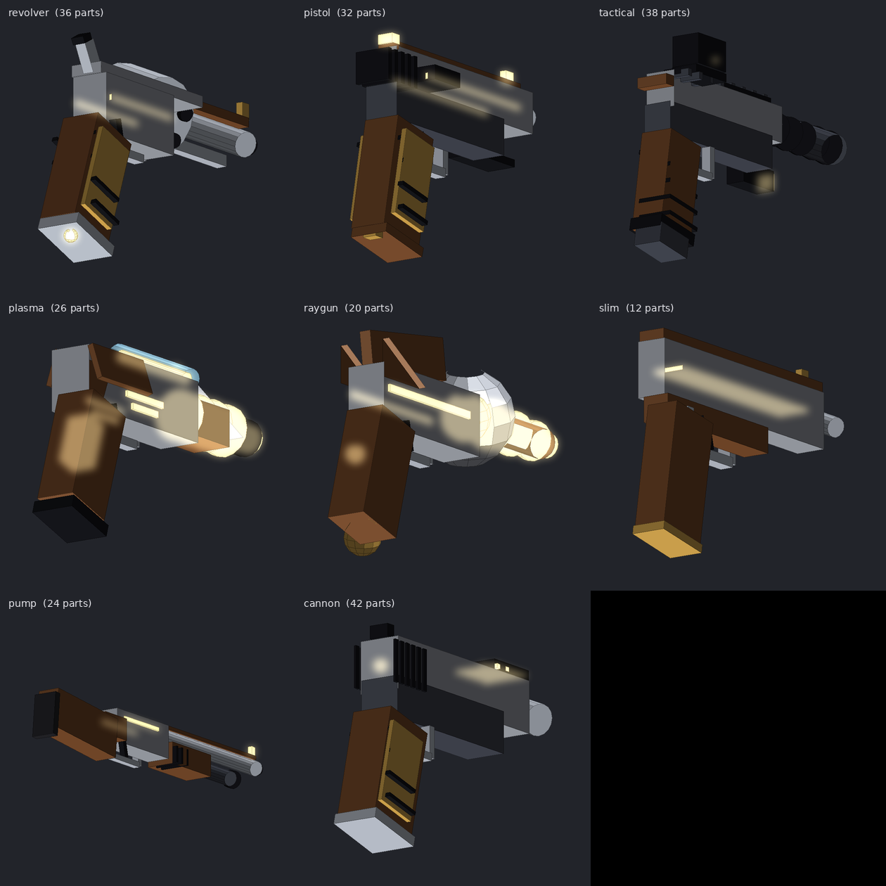
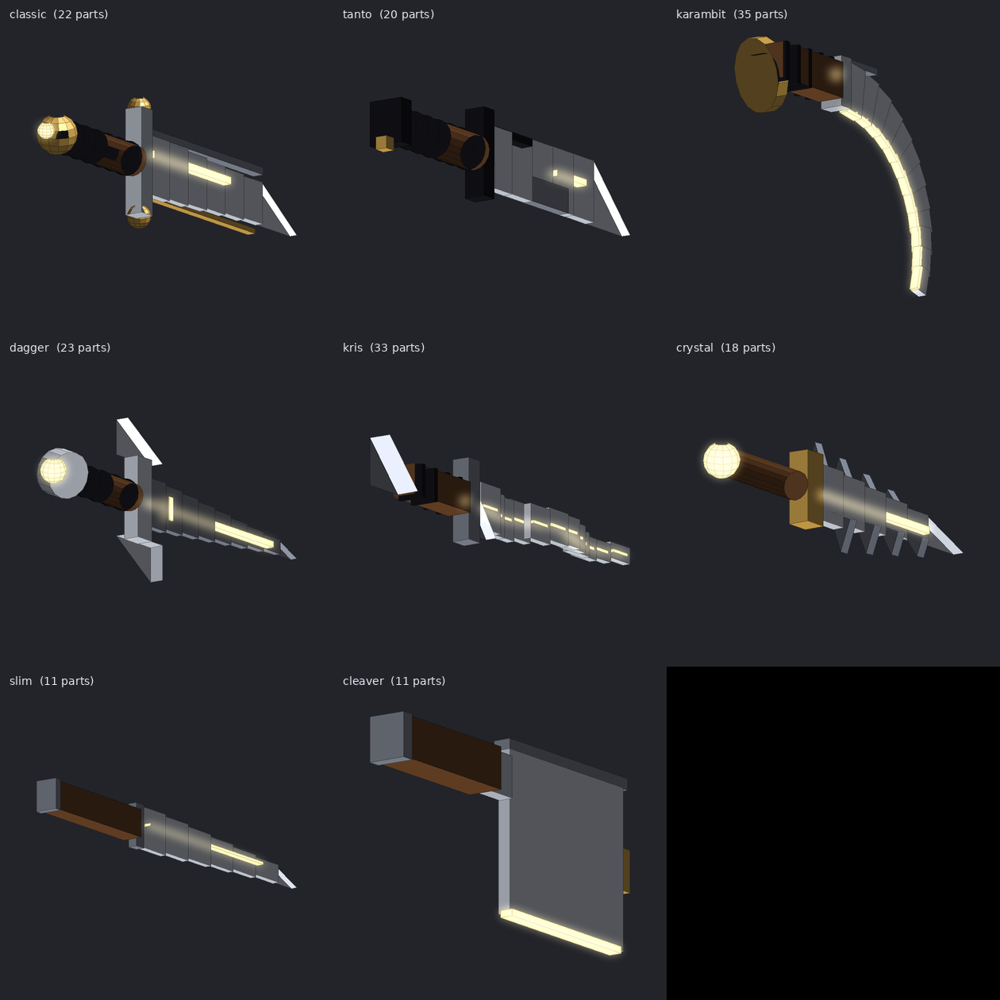
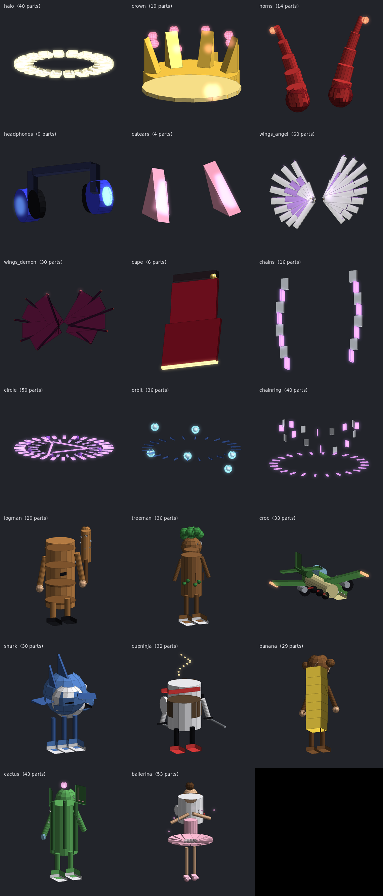

# Customisation: custom gun, custom knife, custom character, two kill sounds

Everything here is **local**: it changes how *your own* gun tool, knife tool and avatar look on *your* screen and what *you* hear.
Other players see and hear nothing of it. Nothing changes damage, fire rate, speed, size, hitboxes or collisions.

*These pictures come from `tools/model_render.py`, a small offline rasteriser (orthographic, simple lighting, fake glow). They show the
shapes and colours of the data in `src/data/Models*.luau`. They are NOT Roblox renders; materials, lighting and glow look different in the game.*

## What was built

| Page (nav group "Customize") | Models | Per-page settings | Module |
|---|---|---|---|
| Custom gun | 8 (Revolver, Compact, Tactical, Plasma, Raygun, Slim, Pump, Cannon) | colours (5), material, glow, decor transparency, effects, fit, presets | `ui/PagesCustom`, `features/CustomLogic`, `features/Cosmetics` |
| Custom knife | 8 (Classic, Tanto, Karambit, Dagger, Kris, Crystal, Slim, Cleaver) | same, **separate** from the gun | same |
| Custom character | 8 costumes + 12 accessories (head / back / aura) | same + slots | same |
| Murderer kill sound | your own list | enabled, volume, selection, applied sound | `features/KillSounds`, `features/KillEvents` |
| Sheriff kill sound | your own list | the same keys under another name | same |

Style categories (gun: Default, Modern, Tactical, Futuristic, Neon, Dark, Metallic, Minimal; knife: Classic, Tactical, Futuristic, Neon, Shadow,
Metallic, Crystal, Minimal; character: Classic, Dark, Neon, Metallic, Minimal, Futuristic) plus **Custom** are palette presets applied over any model.
Eight quick colour palettes sit under them.

## For every function: where, who uses it, when, result, reset, errors, check

| Function | Stored in | Used by | Applied when | Result | Back to default | Errors | Verified by |
|---|---|---|---|---|---|---|---|
| Choose model / colours / material / glow / decor / effects | `custom.<kind>*` (the **draft**) | preview (`ui/PagesCustom`) | immediately, in the preview only | preview model rebuilt (≤ 12 Hz while visible) | Reset | bad values are clamped by the settings schema | `t_custom` |
| Apply | `custom.<kind>Applied` (JSON snapshot) + `custom.<kind>Enabled` | `features/Cosmetics` | on press; the scanner re-applies within ~2 s | a skin welded to your tool or avatar | Reset | no snapshot / unknown model -> refused with a message; no tool -> status "waiting for a 'Gun' tool" | `t_custom` (mock) |
| Reset | same keys | `CustomLogic.reset` | on confirm | look removed, **this page's** draft back to defaults; presets and other pages untouched | n/a | n/a | `t_custom` |
| Save / load / duplicate / delete preset | `custom.<kind>Presets` (JSON, max 20) | `CustomLogic` | on press | per-page named looks, each validated on load | delete (asks first) | empty/long/control-char names, limit, corrupt JSON -> ignored | `t_custom` |
| Preview | nothing stored | `Cosmetics.buildPreview*` | on change / "Preview" | a ViewportFrame with its own copy of the model (mannequin for characters); drag rotates, wheel zooms, buttons reset/auto-rotate/enlarge | Reset view | missing model -> empty preview | `t_custom` (structure only) |
| Own model (Blender etc.) | `cosmetics.<kind>Source` | the older single-source skin | "Use imported model" | `asset:<id>` / `file:<name.rbxm>` model on the tool/avatar, scripts removed | Apply a look again | load failure -> status "error: ..." | `t_roblox` (existing) |
| Kill sound: add / remove | `ksound.<role>Library` (JSON, max 30) | `features/KillSounds` | on press | per-role list | remove | bad name/source (`proc:`, `../`, duplicates) refused | `t_custom` |
| Kill sound: select / preview / stop | `ksound.<role>Pick` | `KillSounds.preview` | on press | one preview per role, a new one replaces the old, an event or unload stops it | Stop | a sound that fails to load reports it and is released | `t_custom` (mock) |
| Kill sound: Apply / Reset / enable / volume | `ksound.<role>Source / Enabled / Volume` | `KillSounds.playEvent` | on a confirmed kill | plays that role's sound at that role's volume | Reset (this role only) | unresolvable source is logged, nothing plays | `t_custom` |

## The two kill sounds are two systems

Murderer and Sheriff never share a key, list, preview player, Apply or Reset. `KillSounds` functions all take the role, and
resetting one role leaves the other byte-for-byte unchanged (tested).

Events (`features/KillEvents`): `MurdererKillConfirmed` = role `murderer`, `SheriffKillConfirmed` = role `sheriff`.

**What "confirmed" means here, honestly.** A client cannot prove who killed whom. A kill is confirmed on *your* client when another
player's character dies (replicated state) shortly after **you** used your knife (murderer, within 45 studs) or your gun (sheriff, within 600
studs). Clicking, swinging or shooting alone never plays anything; a death without your own tool use shortly before never plays anything; one death
fires at most one event (per victim and role). The training range reports its own target kills as `sheriff` (source `training`); the "Test event" button
sends a labelled `test` event through the same pipeline so the sound can be checked. If you are not the one who got the kill but used a tool at the right
moment next to the victim, the sound can still play: it is a local effect, not evidence.

## What is NOT in here, and why

* **No Blender catalogue and no downloaded models.** There is no access to any catalogue from this environment, and the project does not fetch models
  from sites. The eight "brainrot-style" costumes (Tung Tung Sahur, Brr Brr Patapim, Bombardiro Crocodilo, Tralalero Tralala, Cappuccino Assassino,
  Chimpanzini Bananini, Lirili Larila, Ballerina Cappuccina) are **blocky original interpretations built from Parts** in this repository. They are not the
  Blender meshes of those memes or of any other project. To use real meshes you made or have rights to: export from Blender, upload to Roblox (or save a
  `.rbxm` into `MM2Hub/models/`), enter `asset:<id>` or `file:<name.rbxm>` in "Your own model" on each page. Scripts in loaded models are removed.
* **No bundled sounds.** No legal sound ids are available here, so the lists start empty and nothing is invented. Add your own `asset:<id>` or
  `file:<name.mp3>` (in `MM2Hub/sounds/`).
* Costumes are static: they are welded to your root part and do not animate with your limbs. They hide your real avatar only through local
  `Transparency` (restored on removal).
* Detail level: models are 4-60 parts of primitives (blocks, cylinders, balls, wedges), so they are chunkier than real meshes.
* Everything was tested on a mock Roblox (`tests/mock_roblox.luau`) and with offline renders. It has **not** been run in Roblox Studio or an
  executor. Open items to check there: weapon orientation in the hand (use the fit offsets on each page), wedge direction, Neon/Glass look, light and trail
  appearance, ViewportFrame lighting, and whether MM2 keeps its tools as `Tool` + `Handle` (tool names are adjustable on the page).

## Adding a model

1. Add a build function to `src/data/ModelsGun.luau` / `ModelsKnife.luau` / `ModelsChar.luau` using the builder in `data/ModelKit.luau` (roles
   `primary / secondary / grip / detail / glow` follow the user's colours; `steel / black / ...` are fixed) and append its id to `order`.
2. Run `python3 tools/model_render.py --kind gun` to look at it (`dist/models/`), then `python3 tools/run_tests.py`: the catalogue test checks part counts
   (≤ 120), sizes, colours and shapes of every model.
3. For a Russian name add it to `src/data/RuTexts.luau`.
